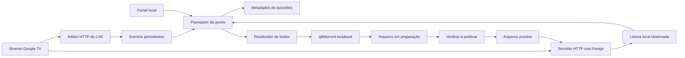

# C4K — design do addon Stremio

**Data:** 2026-11-15. **Estado:** proposta implementável, ainda sem teste na TV.
**Decisão do usuário:** aprofundar o caminho Stremio como cliente principal, com PC servidor e download antecipado dos próximos episódios. Backend .NET; instalador Windows; sem Docker.

**Informações confirmadas nesta revisão:** TCL C6K com Android TV 14; Stremio descrito pelo usuário como mais atual, ainda sem número de build. Usuário pediu manter as duas opções de fontes: addon configurado e entrada manual. Essas respostas substituem a dúvida sobre modelo da TV e preferência de fontes; a escolha do provedor específico continua aberta.

## 1. Experiência alvo

Instalar C4K no PC, escolher disco e perfil, configurar uma fonte e instalar seu addon diretamente no Stremio. O PC exibe endereço LAN e diagnóstico. Na TV, usuário continua navegando no Stremio; arquivos prontos aparecem como opção C4K no detalhe normal do episódio e em catálogo próprio de prontos.

Ao iniciar S01E03, manter S01E04 e S01E05 preparados ou em preparação. Se E04 já existe, não duplicá-lo. Ao iniciar E04, janela passa a E05/E06. Janela padrão proposta de dois episódios, configurável de um a cinco, sujeita a quota global e limite por série. A regra dispara no início, sem esperar atingir percentual assistido.

Primeiro episódio ainda precisa de preparação: adicionar série no painel e indicar início, ou evento de biblioteca quando comprovado. Se usuário assistir inicialmente por outra fonte e os eventos funcionarem, o addon poderá receber o início e preparar os seguintes. Sem eventos, esse cenário não é detectável de modo confiável: preparar primeiro pelo painel e passar a consumir pelo C4K.

Exemplo: E03 está pronto; E04 baixando; E05 aguardando fonte. Só E03 é anunciado como reproduzível. O painel mostra demais estados; não inserir vídeos falsos de progresso nem travar player aguardando download. Stremio pode precisar reabrir lista de fontes para atualizar; catálogo não é dashboard em tempo real.

## 2. O que foi comprovado documentalmente

O protocolo e o core públicos descrevem player/library; código introduzido em setembro de 2026 torna plausível ouvir atividade sem ler credenciais da conta. Publicação no Android TV do usuário continua desconhecida. Detalhes e links rastreáveis: [STREMIO-SOURCES.md](research/STREMIO-SOURCES.md).

Nenhum resultado desta pesquisa autoriza afirmar que um addon lê todos os addons instalados, recebe a fonte selecionada em outro addon ou reconstrói a biblioteca anterior. Evento de início traz identidade/tempo, não uma fonte reutilizável. C4K precisará resolver sua própria fonte.

## 3. Arquitetura

Um único host ASP.NET Core .NET 10 LTS contém addon, painel, media endpoint e workers. SQLite guarda estado. qBittorrent é processo nativo separado controlado via API local. Direct play é prioridade; não há transcodificação própria. Interface Razor Pages evita runtime Node no uso e reduz componentes.

Estrutura proposta: `src/C4K.App` (host/endpoints/UI/workers), `src/C4K.Core` (políticas/modelos), `src/C4K.Infrastructure` (SQLite, HTTP, qBittorrent, disco), `tests/C4K.Tests` (políticas e contratos), `installer/` e `docs/`. Começar com esses três projetos; não usar microserviços.

## 4. Gatilhos em ordem de confiança

| Entrada | O que sabemos | Ação permitida |
|---|---|---|
| Player start em cliente comprovado | Episódio iniciado/retomado | Assegurar janela N+1/N+2, idempotente |
| Leitura HTTP de mídia C4K | Cliente leu bytes desse arquivo | Inferir consumo local e assegurar janela; não marcar assistido |
| Library add comprovado | Série adicionada depois de instalar addon | Criar monitoramento e aplicar início configurado; sem histórico, não adivinhar episódio atual |
| Watched com episódios explícitos | Marcação informada pelo usuário/cliente | Atualizar histórico recebido e replanejar; não apagar arquivos |
| Consulta stream/meta/catalog | Navegação/prefetch possível | Apenas consultar; nunca assumir reprodução ou baixar por padrão |
| Ação no painel | Intenção explícita | Preparar série a partir de episódio informado |

Evento é persistido antes de resposta rápida; worker faz operações lentas fora da requisição. Não existe promessa de entrega garantida, heartbeat contínuo ou replay. Retorno `200 {}` sem cache para eventos válidos; falha de persistência não deve retornar sucesso, embora retry do cliente não seja garantido.

Não confiar em HEAD, listagem de fontes ou um Range de probe como início certo. Após GETs de mídia com bytes efetivamente enviados e pequena janela de observação configurável, emitir `LocalConsumptionObserved` de confiança limitada. Buffer/prefetch do player ainda pode gerar falso positivo; efeito deve ser apenas preparação limitada por quota. HTTP byte offset não mede progresso assistido em MKV/MP4. Não usar para percentual ou exclusão automática.

## 5. Eventos, identidade e estado

Mapear episódio por IMDb/série + season/episode quando identidade Cinemeta for reconhecida. IDs de outros catálogos exigem adaptador; tratar desconhecidos como não suportados com diagnóstico. Metadados definem sequência de episódios: não somar um ao número ignorando fim de temporada, especiais, episódios duplos e ordem de exibição.

Dados: `DeviceProfile`, `SeriesSubscription`, `Episode`, `WatchObservation`, `DownloadIntent`, `SourceCandidate`, `DownloadJob`, `ReadyFile`, `PairingToken`, `Settings`. Chave única de intenção: perfil + ID canônico do episódio + perfil de mídia. Preservar mapeamento origem→ID e fileIndex→episódio para torrents com pacotes.

Inbox atribui ID local e receivedAt; protocolo pode não fornecer eventId/timestamp de origem. Guardar observação bruta sanitizada por retenção curta; tolerar repetição de start/seek e ordem de chegada imperfeita. Não deduplicar eternamente eventos idênticos que podem ocorrer em sessões diferentes. Usar janela de dedupe curta e intenção única persistente para impedir downloads duplicados. Evento antigo não deve fazer monitoramento retroceder automaticamente; usuário pode escolher reassistir.

No MVP, token define um perfil doméstico; não assumir que eventos tragam identidade física de dispositivo ou usuário. Addon sincronizado pela conta pode operar em mais de um aparelho. Perfis separados requerem tokens/instalações distinguíveis, verificados no cliente.

Estados de aquisição: `Planned → Resolving → Queued → Downloading → Verifying → Publishing → Ready`; exceções `WaitingForRelease`, `NoSource`, `Stalled`, `NoSpace`, `Paused`, `Failed`, `Cancelled`. Separar observação de reprodução do estado de arquivo. Ready exige conclusão do arquivo selecionado e publicação final, nunca apenas porcentagem de torrent arredondada.

## 6. Fontes e automação real

Fornecer duas estratégias de `ISourceResolver`:

1. Manual: magnet/torrent autorizado ou associação de arquivos/pacote da temporada. Serve à prova inicial e independe de serviço de busca.
2. Addon configurado: usuário cadastra URL de manifest e configuração de provedor compatível. C4K consulta recurso stream do próximo episódio com timeout, backoff e cache curto. Implementar contrato genérico e fixar um provedor real em teste antes de prometer interoperabilidade.

O servidor não herda lista de addons nem chaves da conta Stremio. Credenciais de provedor são configuradas no PC e protegidas; nunca inseridas em URLs de mídia devolvidas à TV. Excluir o próprio C4K da lista de provedores para evitar recursão.

Candidato torrent (`infoHash`, `fileIdx`, trackers permitidos) vira job qBittorrent e seleção explícita de arquivo. Pacote sem mapeamento claro entra em seleção manual; nunca escolher maior arquivo e chamar de próximo episódio. URL HTTP baixável só entra se persistência e autorização forem compatíveis. `externalUrl`, YouTube, DRM, manifest adaptativo ou esquemas desconhecidos não são download suportado no MVP. URLs assinadas podem expirar: resolver de novo, respeitando política e sem loops.

Seleção determinística por identidade → compatibilidade da TV → idioma/legenda → qualidade → tamanho → disponibilidade observável. Nomes de release e supostos seed counts de textos não são evidência confiável. Preferência padrão: perfil 4K compatível com tamanho limitado e fallback 1080p somente autorizado pelo usuário. Nunca degradar qualidade silenciosamente nem garantir raridade resolvida por novo addon.

## 7. Algoritmo da janela

Para cada início/ação válida, obter os próximos K episódios lançados da ordem canônica; garantir intenções faltantes com transação e chave única. Ignorar Ready e jobs existentes. Se próximo ainda não foi lançado, registrar WaitingForRelease e consultar agenda com frequência limitada. Respeitar cancelamentos explícitos e itens fixados pelo usuário.

Prioridade: episódio explicitamente solicitado > próximo episódio da série ativa > segundo episódio > antecipação de outras séries. Proposta inicial: um download pesado por vez; liberar dois somente após diagnóstico. Restringir banda em reprodução se download competir com leitura/Wi-Fi. Quota global evita que iniciar muitas séries lote disco. Não baixar uma temporada inteira por um simples libraryAdd.

Estimativa informativa: bytes restantes / taxa recente, com confiança baixa quando amostra insuficiente; nunca prometer que terminará antes dos créditos. Se fontes travam, retry com limite e troca de candidato configurada; sem candidato elegível, mostrar NoSource/Stalled. PC reiniciado reconcilia torrent IDs e intenções antes de retomar fila.

## 8. Contrato HTTP proposto

Porta proposta 48240, configurável, sem conflito assumido. Paths ilustrativos com valores fictícios, token real nunca em documentos/logs:

Admin deve usar listener separado em `127.0.0.1:48241`, no mesmo host, com validação de porta local por endpoint. `/admin/` não é acessível pelo listener LAN 48240; não basta omitir link ou verificar apenas Host enviado pelo cliente. Autenticação/CSRF administrativos continuam obrigatórios mesmo em loopback.

| Endpoint | Função |
|---|---|
| `/a/{addonToken}/manifest.json` | Manifest privado e recursos suportados |
| `/a/{addonToken}/catalog/series/c4k-ready.json` | Séries com episódios locais prontos |
| `/a/{addonToken}/meta/series/{id}.json` | Metadados locais/cached e episódios |
| `/a/{addonToken}/stream/series/{videoId}.json` | URLs apenas de Ready |
| `/a/{addonToken}/player/series/{videoId}/{extra}.json` | Entrada de atividade, se cliente suportar |
| `/a/{addonToken}/library/series/{id}/{extra}.json` | Entrada de biblioteca, se cliente suportar |
| `/m/{mediaToken}/{opaqueFileId}` | Arquivo completo, GET/HEAD e Range |
| `/admin/` | Painel loopback com sessão administrativa própria |
| `/health/live`, `/health/ready` | Vida do host e estado das dependências, sem segredos |

Recursos de filme usam type movie e têm preparação única, sem janela. Manifest declara filtros de tipo/ID explícitos. Eventos não suportados pelo cliente são diagnosticados, não mascarados. JSON válido nos endpoints de addon, CORS conforme protocolo. Admin não compartilha política CORS aberta.

Stream de Ready retorna `url` LAN, nome C4K e identificação de qualidade/tamanho. `behaviorHints.bingeGroup` estável por perfil de qualidade busca continuidade no próprio addon; não garante seleção contra todos os addons e configurações. `notWebReady` e filename/hash/size conforme protocolo ajudam player/legendas. Nunca devolver `infoHash` como opção C4K pronta: isso transferiria aquisição à TV.

Range deve responder 206/Content-Range correto, 416 para intervalo inválido, HEAD sem corpo, MIME/Content-Length corretos, ETag estável e cancelamento. ASP.NET Core PhysicalFile com enableRangeProcessing é base; testes de integração cobrem autenticação, suffix/open-ended ranges e seek. Não carregar vídeo inteiro em RAM. TV referencia IP LAN do PC, jamais localhost.

Tokens de addon e mídia são capacidades revogáveis separadas do admin. Proposta: token opaco durável por pareamento, revogável, para evitar que URL expirada em cache quebre autoplay; comprovar cache e rotação antes de definir TTL. Token de mídia não permite escrever desejos; addon só provoca ações dentro das quotas configuradas. Limitar taxa e tamanho de eventos.

## 9. LAN, transporte e instalação do addon

Não publicar addon no catálogo comunitário. Instalar diretamente pelo manifest e sincronizar na conta/cliente quando suportado; a TV precisa alcançar a LAN do PC. Testar fluxo com link `stremio://` e instalação manual; instalação no desktop pode validar URL no próprio desktop, então não prova acesso na TV.

Primeiro testar HTTP LAN e IP reservado DHCP. Se aceito, é o caminho doméstico sem infraestrutura externa. HTTP em LAN não cifra tokens; informar no pareamento e restringir firewall à rede privada. Se manifest exigir HTTPS, testar HTTPS local confiável com requisito real de certificados do cliente; não prometer autoassinado. Domínio/certificado público implicam dependência operacional extra mesmo sem expor porta da mídia; isso deve ser opção explícita, nunca requisito oculto de standalone. Se não houver transporte aceitável sem infra extra, declarar gate reprovado e reavaliar antes de desenvolver restantes fases.

Nome `.local` e descoberta mDNS são conveniência, não dependência. Rede convidada/AP isolation, VPN e mudança de IP devem ter diagnóstico. Endereço sincronizado a aparelho fora de casa deve falhar sem expor mídia; não adicionar túnel ou port forwarding automaticamente.

## 10. Disco, arquivos e reprodução

Separar downloads e ready; publicar por hardlink em mesmo volume ou cópia temporária + rename no destino. Considerar espaço adicional da cópia e duração do seeding. Conclusão por arquivo permite episódio pronto em pacote parcialmente baixado, desde que verificação das peças correspondentes esteja comprovada; primeira implementação pode exigir conclusão integral do job se API não comprovar essa condição, mostrando a limitação.

Quota inicialmente protege conteúdo não assistido e arquivos em leitura. Remoção manual cancela referência de publicação com confirmação e só libera bytes quando não há outros hardlinks/referências. Não automatizar exclusão por evento stop/offset. Legendas SRT locais podem ser servidas com token restrito; embutidas e hash para addons externos exigem teste. Download completo não resolve codec/HDR/áudio incompatível: escolher release compatível ou declarar necessidade de outro player, sem transcode próprio oculto.

## 11. Instalador e execução

App self-contained win-x64, Inno Setup e qBittorrent nativo com versão/API fixadas após teste. Preferir instalação por usuário e início no login para MVP, com bandeja/atalho e orientação para manter PC acordado; serviço antes de login é requisito separado. Logs rotativos locais sem tokens, senhas ou paths privados completos. Dados/configuração fora do diretório de binários; upgrade faz backup de SQLite e mantém mídia por padrão.

Wizard: pasta → quota/perfil → detectar qBittorrent → configurar provedor/manual → testar conexão → exibir manifest/link de instalação → testar TV → escolher janela. Obter componentes oficiais verificados ou empacotar conforme licenças; nenhum SDK ou Docker no PC de uso. Não alterar instalação qBittorrent existente sem consentimento; credencial/porta controladas e API em loopback.

## 12. Prova de conceito antes da construção completa

Gate A — transporte e reprodução: instalar manifest privado; filme/episódio de amostra autorizado completo; tocar na TV, seek, áudio, legendas e 4K. Registrar modelo da TV, versão Stremio, player e conectividade. Sessão de 60 minutos sem rebuffer após início é meta, não resultado existente.

Gate B — eventos: addon diretamente instalado e endpoint diagnosticável; iniciar por fonte C4K e outra fonte, pausar, retomar, seek, trocar episódio, encerrar, add/remove library e watched/unwatched. Registrar recebimento e campos, testar duração zero e app encerrado abruptamente. Provar também se eventos de player externo chegam. Simulações HTTP não aprovam compatibilidade Android TV.

Gate C — fallback: desabilitar eventos; consumir mídia local e verificar criação única de N+1/N+2. HEAD e consulta stream não iniciam jobs. Probes podem produzir preparação antecipada limitada; registrar margem de falsos positivos.

Gate D — fonte: consultar um provedor escolhido ou torrent autorizado de teste, mapear próximo episódio e baixar com qBittorrent; evento sozinho não passa este gate. Validar pacote, fonte indisponível e retomada.

Decisão: A+B+D aprovados → experiência automática completa proposta. A+C+D aprovados → experiência automática ao assistir pelo C4K, com entrada manual inicial. A reprovado → não avançar com addon local sem resolver transporte/player. B reprovado não autoriza prometer monitorar atividade em outras fontes.

Testes seguintes: dedupe/reinício, fim de temporada/especiais, limite de disco, múltiplas séries, fonte expirada, tokens revogados, arquivos parciais, path traversal, HTTP redirects/SSRF, atualização em Windows limpo e repetição desejo→download→TV. Testes de acesso externo não exigem abrir rede do usuário.

## 13. Decisões ainda abertas

Build/player Stremio exatos na TCL C6K Android TV 14; hardware/rede/disco do PC; provedor de fontes e suas capacidades; política HTTP LAN aceitável no cliente; janela/quota final; necessidade antes do login. Gates físicos e provedor real precisam de resposta antes da entrega funcional. Não foi instalado software, acessada conta Stremio ou executado teste de reprodução nesta revisão.
