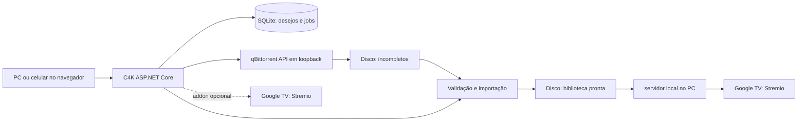

> Histórico da primeira proposta, substituído pelo design Stremio principal em 2026-11-15. Não usar como escopo vigente.

# Arquitetura proposta

## Limites

C4K administra desejos, fontes, jobs, espaço e publicação; qBittorrent transfere e verifica peças. O host local serve os arquivos completos à TV. SQLite não armazena vídeos. Nada de abrir portas no roteador.

Entidades: MediaTitle (tipo e IDs externos), Episode (temporada/episódio), Wish (perfil, prioridade e escopo), Source (tipo e referência), DownloadJob (ID remoto, estado e progresso), LibraryItem (arquivo validado e identidade), Settings e JobEvent. Índices únicos para evitar duplicação de desejo e importação. Credenciais em armazenamento protegido do Windows; logs sem segredos.

## Fluxo persistente

`Desejado → AguardandoFonte → NaFila → Baixando → Verificando → Importando → Pronto`.
Estados paralelos de controle: `Pausado`, `SemEspaço`, `SemProgresso`, `Falhou`, `Cancelado`. Preservar origem e histórico de transições. Nunca inferir Pronto só por percentual arredondado.

1. Usuário adiciona filme ou escopo de série e fonte autorizada. Sem fonte, permanece aguardando; pesquisa por metadados não equivale a encontrar arquivo.
2. Worker reserva orçamento de disco, envia job idempotente e grava identificador remoto. Ao reiniciar, reconcilia com qBittorrent antes de criar novo job.
3. Para torrent multifile, selecionar episódio/arquivo explicitamente; não marcar temporada inteira pronta por um episódio concluído.
4. Depois da conclusão e verificação do arquivo selecionado, validar extensão e leitura; biblioteca não aponta para pasta de incompletos.
5. Hardlink quando possível em mesmo volume; cópia com arquivo temporário em destino e rename final quando necessário. Conferir espaço para cópia. Não mover arquivo ainda referenciado pelo cliente de torrent.
6. Publicar nomes estáveis por filme/ano e série/temporada/episódio e atualizar o catálogo de arquivos prontos do addon.

## Segurança e rede

Painel começa em loopback; acesso celular LAN exige habilitação e autenticação. Web API qBittorrent apenas loopback com credencial, preservando proteções nativas. servidor local exposto somente à rede privada conforme firewall. Nunca servir caminho recebido em URL; resolver ID opaco para raiz permitida, rejeitando traversal, junctions fora da raiz e arquivos parciais. Downloads HTTP precisam validar redirects, destino e esquemas contra SSRF. Mídia não executa conteúdo recebido.

PC preferencialmente por Ethernet gigabit; TV pode continuar por Wi-Fi 5/6 em 5 GHz ou 6 GHz se suportado. Reserva DHCP e ausência de isolamento entre clientes evitam endereço mutável e falha de descoberta. Testar throughput real, não apenas velocidade nominal ou teste de internet.

## Adaptador Stremio condicionado

Implementar manifest, catalog, meta e stream por HTTP/JSON .NET. Stream deve retornar `url` para mídia pronta; retornar `infoHash` faria o cliente buscar torrent, contrariando objetivo. Associar filme IMDb e série `tt...:temporada:episódio`. Media endpoint precisa de HTTP Range, seek, cancelamento e autenticação compatível com player. Não exigir cabeçalhos que o cliente não saiba enviar; testar tokens de reprodução sem expor credencial administrativa.

Não usar localhost na URL devolvida à TV. Provar instalação e reprodução no cliente real com IP LAN, política HTTP/HTTPS, CORS e resolução de nome. Não prometer que um certificado autoassinado funcione. Se HTTP LAN não for aceito, avaliar HTTPS confiável sem publicar mídia; se exigir infraestrutura incompatível com standalone, documentar servidor local como fallback e não considerar addon entregue.

Sincronização da lista pessoal é outro adaptador: recursos de stream recebem consultas de reprodução, não notificações de novo desejo. Exigir API/autorização estável comprovada antes de implementar. Não guardar senha Stremio nem tratar abertura de detalhe de filme como inclusão na lista.

Fontes: [protocolo de stream](https://stremio.github.io/stremio-addon-sdk/api/responses/stream.html), [IDs de episódios](https://stremio.github.io/stremio-addon-sdk/api/requests/defineStreamHandler.html), [API qBittorrent](https://github.com/qbittorrent/qBittorrent/wiki/WebUI-API-(qBittorrent-5.0)). O desenho de jobs e arquivos é proposta própria a validar.
