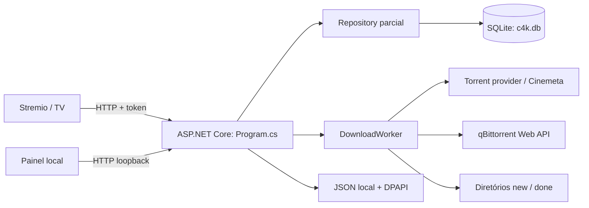

# Revisão de arquitetura e design de software — C4K

**Data:** 24/11/2026  
**Escopo:** código em `src/C4K.App` e `tests/C4K.LibraryTests`, com foco em estrutura, robustez, manutenção e boas práticas.  
**Método:** leitura estática do código e dos artefatos de planejamento disponíveis. Os testes não foram executados nesta revisão; os resultados históricos citados no planejamento não foram reproduzidos.

## Resumo executivo

O C4K tem uma base funcional coerente com um aplicativo desktop de escopo controlado: ASP.NET Core hospeda o addon e o painel, SQLite mantém estado durável, `BackgroundService` coordena downloads e limpeza e o sistema publica mídia diretamente do disco local. Há decisões cuidadosas em segurança de caminhos, armazenamento de senha com DPAPI, deduplicação de solicitações, recuperação por hash e proteção contra publicação de arquivos incompletos.

O principal limite arquitetural é a concentração de responsabilidades. `Program.cs` contém bootstrap, segurança HTTP, configuração, validação, lógica de aplicação e contratos Stremio. `Repository` é uma fachada parcial que também coordena regras de domínio e estados de automação. `DownloadWorker` combina integração HTTP, orquestração, política de retries, sistema de arquivos, persistência e exclusão física. Isso torna mudanças arriscadas e dificulta testes isolados.

**Avaliação geral:** desenho apropriado para um monólito local inicial, mas ainda frágil para evolução e recuperação consistente de falhas. Recomenda-se modularizar como monólito, sem introduzir microsserviços nem abstrações genéricas prematuramente.

## Arquitetura observada



O host injeta `Repository`, `MediaFiles`, `AutomationSettings` e `DownloadWorker` como singletons. O próprio worker é registrado também como hosted service. O repositório abre conexões SQLite por operação, inicializa tabelas no construtor e mantém coleções/estados serializados em JSON para downloads e planos watched. Os arquivos HTML servidos pelo host incluem JavaScript para chamar os endpoints administrativos.

## Pontos fortes que devem ser preservados

- O acesso ao painel está restrito à porta loopback, IP de loopback e hosts locais; as rotas públicas do addon e mídia são separadas das rotas administrativas (`Program.cs`).
- Eventos e criação de intenção de download podem ser gravados na mesma transação SQLite (`Repository.Record`). Isso reduz a chance de perder a intenção depois de registrar o evento.
- Hash do torrent é persistido antes da chamada remota, permitindo consultar a tarefa depois de uma interrupção (`DownloadWorker.Process`).
- O sistema verifica estado, tamanho e acesso do arquivo antes de registrá-lo como mídia disponível.
- `MediaFiles` rejeita caminhos fora da raiz, extensões não permitidas e componentes marcados como reparse point.
- Exclusão valida propriedade do torrent, uso compartilhado e arquivo aberto antes de apagar; qBittorrent recebe `deleteFiles=false`.
- A senha do qBittorrent é protegida com DPAPI e não é incluída na projeção pública de configurações (`AutomationSettings`).
- A regra de preparação de episódios (`EpisodePlanner`) está separada do worker e pode ser exercitada sem chamadas de rede.
- O projeto compila com nullable ligado e warnings tratados como erros.

## Achados e recomendações prioritárias

### P1 — Falta de fronteiras entre camadas

**Evidência:** `Program.cs` configura o host e também implementa endpoints, validação de metadados, alterações de arquivos/configuração, serialização do manifest Stremio e autorização. `Repository.Record` decide quando eventos criam planos/downloads. `DownloadWorker` executa chamadas externas, atualiza estado, resolve arquivos e exclui dados.

**Impacto:** mudanças em contratos HTTP podem afetar regras internas; regras têm de ser testadas através de componentes com dependências concretas; transações e locks são coordenados em diferentes arquivos; uma alteração de fluxo pode introduzir efeitos parciais difíceis de reparar.

**Melhoria:** dividir o monólito por módulos e responsabilidades. Extrair primeiro `AddonEndpoints`, `AdminEndpoints` e `MediaEndpoints`; criar serviços de aplicação como `RecordStremioEvent`, `QueueDownload`, `RetryDownload`, `DeleteMedia` e `ChangeLibraryRoot`. Manter endpoints como adaptadores que validam entrada HTTP, chamam um serviço e traduzem o resultado para HTTP.

### P1 — Modelo de estado persistido sem validação tipada ou transições centralizadas

**Evidência:** downloads e planos são armazenados como `body TEXT` serializado (`Repository.Downloads`, `Repository.WatchedPlans`). Valores como `Queued`, `Resolving`, `Downloading`, `Ready`, `Failed`, `Removed`, `Cancelled`, `Retry` e `WaitingRelease` são strings distribuídas por worker, repositório, endpoints e painel. Algumas leituras usam `JsonSerializer.Deserialize<T>(...)!` sem tratamento de conteúdo inválido.

**Impacto:** erro de digitação ou JSON antigo/corrompido pode interromper o worker ou produzir estados impossíveis. Não há restrição no banco para impedir transições ilegais ou atualizações concorrentes sobre uma versão antiga do job.

**Melhoria:** definir enums/uniões para estados, mapeá-los para colunas SQLite e centralizar transições em métodos que aceitem apenas estados de origem válidos. Adicionar `version` ou `updated_at` para controle otimista. Ao carregar JSON legado durante uma migração, validar explicitamente e registrar uma falha recuperável, sem derrubar todo o ciclo do worker. Preferir colunas relacionais para campos consultados/filtrados; reservar JSON para payloads versionados que realmente variam.

### P1 — Operações compostas entre banco, qBittorrent e disco não têm recuperação transacional explícita

**Evidência:** `DeleteCore` remove primeiro a tarefa remota, depois apaga legenda e vídeo e por fim remove o registro SQLite. A publicação do download registra mídia e atualiza estado do job em operações distintas. SQLite não pode transacionar junto com qBittorrent ou filesystem.

**Impacto:** falha entre efeitos pode deixar torrent removido com arquivo ainda cadastrado, arquivo apagado com linha SQLite residual ou item pronto sem estado de job correspondente. A idempotência ajuda, mas o processo de recuperação não está modelado como fluxo explícito.

**Melhoria:** tratar exclusão e publicação como sagas locais persistidas: gravar intenção/fase, executar cada efeito idempotente, confirmar a fase e reconciliar ao iniciar. Para excluir, por exemplo, persistir `DeletePending`, desanexar torrent sem apagar arquivos, apagar arquivos exatos, então finalizar o catálogo; em falha, reexecutar ou expor erro acionável. Para publicação, garantir que a inserção de mídia e atualização para `Ready` ocorram na mesma transação.

### P1 — Concorrência protegida por locks ad hoc e com granularidade ampla

**Evidência:** `DownloadWorker.Gate` serializa o loop inteiro, inclusive chamadas de rede. Algumas rotas administrativas adquirem esse gate, outras usam `libraryGate`, e várias escritas/leitura do root e registro de mídia não usam ambos. `MediaFiles.Root` é mutável. `Repository.SaveDownload` atualiza JSON sem condição sobre estado/versão.

**Impacto:** uma chamada lenta ao provedor ou qBittorrent atrasa todas as tarefas; a combinação de dois mecanismos de sincronização aumenta o risco de corrida e deadlock lógico; uma solicitação concorrente pode salvar uma decisão calculada com estado desatualizado.

**Melhoria:** definir um modelo de concorrência explícito. Separar o lock curto de configuração/raiz do processamento de rede; não manter locks de aplicação durante I/O remoto. Usar claims/leases persistidos por job (`Queued → Processing`, lease com expiração) e updates condicionais no SQLite para permitir retomada segura. Para a mudança de raiz, encapsular root e validação em um serviço sincronizado ou publicar uma configuração imutável versionada.

### P1 — Entrada do painel local sem autenticação de usuário

**Evidência:** o painel depende de porta loopback, validação de host/origem e cabeçalho customizado `X-C4K-Admin: 1`; a checagem de `Origin` só rejeita origem divergente quando esse cabeçalho está presente. Não há identidade ou segredo administrativo no protocolo local.

**Impacto:** qualquer processo local que consiga acessar o listener pode chamar ações administrativas. O cabeçalho reduz CSRF vindo de navegadores comuns, mas não é autenticação de cliente. O risco é limitado ao próprio PC e deve ser descrito como tal.

**Melhoria:** considerar um token administrativo aleatório por instalação, servido ao painel por uma sessão protegida, ou autenticação Windows/Named Pipes para operações administrativas. Se o escopo continuar sendo usuário único local, documentar explicitamente o limite de confiança e manter a exigência de loopback, host validado, origem obrigatória nas mutações e proteção CSRF.

### P2 — `Program.cs` é a composition root e também o controlador de aplicação

**Evidência:** inicialização síncrona de settings/diretórios, seleção de portas, configuração do Kestrel, middleware, políticas de segurança, dezenas de endpoints e contratos de resposta coexistem no mesmo arquivo.

**Impacto:** o arquivo é difícil de navegar e cenários HTTP dependem de estado mutável capturado em closures (`settings`, `publicUrl`). Os erros são convertidos globalmente, o que dificulta respostas consistentes por endpoint.

**Melhoria:** manter em `Program.cs` somente composição e configuração. Criar extensões `AddC4K...`/`Map...Endpoints` ou classes de módulos. Introduzir `IOptions<T>` com validação de startup para portas, URLs e configuração persistida, e resultados de aplicação explícitos para erro de validação, conflito e falha externa.

### P2 — Integrações externas não têm políticas e contratos isolados

**Evidência:** `DownloadWorker` cria `sourceHttp` diretamente; cada operação `Client()` cria um `QbitClient`; o worker também chama Cinemeta diretamente. Timeout, classificação de falha e chamadas HTTP ficam próximos da lógica de negócio. A resposta do provedor é interpretada por `TorrentSource`.

**Impacto:** testes de lógica precisam conhecer transporte; erros transitórios e permanentes são misturados; não há política comum de retry/backoff com jitter e limite, nem telemetria por operação externa.

**Melhoria:** criar `ITorrentProviderClient`, `IQBittorrentClient` e `IMetadataClient` (interfaces pequenas orientadas às operações usadas), implementá-las com `IHttpClientFactory` e options tipadas. Aplicar timeout por operação, retry apenas em falhas transitórias seguras, backoff com jitter, limites de resposta e mensagens de erro estruturadas. Não repetir automaticamente operações remotas não idempotentes sem consulta de reconciliação.

### P2 — Persistência e migrações ainda estão acopladas à construção do repositório

**Evidência:** `Repository` cria tabelas e invoca inicializadores parciais no construtor (`Repository.cs`); não há versão de schema explícita visível. Há tabelas normalizadas para mídia/eventos, mas downloads e watched plans guardam o agregado como JSON.

**Impacto:** falhas de inicialização aparecem durante composição; evolução de schema fica difícil de revisar e testar em sequência; estratégia para dados inválidos e rollback é implícita.

**Melhoria:** mover schema para migrações numeradas executadas por um inicializador explícito, manter `user_version` do SQLite, adicionar índices para consultas do worker, e testar migração de cada versão anterior para a atual. Colocar SQL/mapeamentos em classes de persistência específicas (`SqliteMediaRepository`, `SqliteDownloadStore`, etc.) em vez de uma classe parcial que representa vários agregados.

### P2 — Worker serial mistura coordenação, política e I/O, com observabilidade insuficiente

**Evidência:** `ExecuteAsync` processa limpeza, planos watched, conexão qBittorrent e todos os jobs em um ciclo serial de cinco segundos. Exceções são em geral reduzidas a texto amigável; o host limpa os provedores de log e registra somente o tipo da exceção (`Program.cs`).

**Impacto:** difícil diagnosticar causa raiz e duração; tarefas independentes bloqueiam umas às outras; reinícios e backoff são pouco visíveis; erros internos podem ficar sem contexto suficiente.

**Melhoria:** separar loops/serviços hospedados por responsabilidade, ainda que compartilhem o banco. Adicionar logging estruturado com IDs de correlação e job, métricas de duração/tentativas/fila e health checks distintos para processo, SQLite e qBittorrent. Redigir tokens, magnets e credenciais. Manter mensagens resumidas para o painel, mas guardar detalhes técnicos seguros nos logs.

### P2 — Dependências de ambiente e configurações persistidas têm validação desigual

**Evidência:** defaults e caminhos são definidos no bootstrap; vários arquivos JSON são carregados por `Deserialize(...)!`; `AppSettings.Load` valida tamanho dos tokens, mas `AutomationSettings.Load` não verifica `null`, valores ausentes ou formato antigo. Há estado duplicado em arquivos JSON e SQLite.

**Impacto:** um arquivo truncado pode impedir o aplicativo de iniciar; configuração inválida pode só falhar mais tarde no worker; não há política única de backup/reparo.

**Melhoria:** criar classes de options separadas por subsistema, validar antes de iniciar workers e apresentar erro de configuração acionável. Usar escrita atômica consistentemente, backup rotativo dos arquivos pequenos e migração/versionamento. Centralizar o que é fonte de verdade para cada configuração; evitar cópias divergentes entre settings, arquivo e campos em banco.

### P3 — Estrutura de testes concentra muitos cenários em um executável de console

**Evidência:** `tests/C4K.LibraryTests/Program.cs` contém fixtures, helpers, fakes e centenas de verificações `Check(...)` em um único fluxo sequencial. O projeto não referencia um framework de teste.

**Impacto:** isolamento e execução seletiva são limitados; falha inicial pode impedir os cenários posteriores; paralelismo, relatórios padrão e cobertura automatizada dependem de tooling adicional.

**Melhoria:** migrar gradualmente para xUnit/NUnit/MSTest, com testes por unidade/serviço, fixtures temporárias por teste e `HttpMessageHandler` fake. Separar testes de domínio, persistência/migração, integração HTTP e segurança de filesystem. Manter testes de contrato de alto nível como integração em processo. Cobrir sobretudo falhas entre etapas, concorrência, JSON corrompido e retomada após interrupção.

### P3 — Interface web embutida em arquivos HTML longos

**Evidência:** `LibraryPanel.html` e `LibraryList.html` incluem HTML, CSS e JavaScript inline; `LibraryPanel` contém polling a cada três segundos e `LibraryList` a cada oito segundos.

**Impacto:** lógica de tela não é validada por compilador/linter e é mais difícil de testar ou organizar; polling completo pode crescer em custo conforme a biblioteca e histórico aumentam.

**Melhoria:** extrair CSS/JS para assets estáticos versionados. Separar cliente API, estado da tela e renderização. Adicionar timeout/cancelamento e backoff no polling; atualizar somente dados alterados ou oferecer endpoint compacto/delta. Preservar construção de DOM via `textContent` e não concatenar dados não confiáveis em `innerHTML`.

### P2 — Worker legado e contratos de importação desativados permanecem no código ativo

**Evidência:** `ImportWorker` mantém lógica completa de cópia/hardlink e retomada, mas não é registrado como hosted service no host atual. Algumas rotas ainda aceitam objetos de importação e respondem com mensagens que dizem que cópias/importações foram desativadas.

**Impacto:** leitores podem supor que essa implementação está ativa; lógica de segurança e manutenção fica duplicada em relação ao fluxo atual, e contratos mortos aumentam a superfície de mudança.

**Melhoria:** decidir entre remover o worker/rotas antigas e os testes correspondentes ou isolá-los claramente como compatibilidade legada com documentação e teste explícito de não registro. Manter apenas um caminho de publicação de mídia como fonte de verdade.

## Estrutura-alvo sugerida

Para o tamanho atual, manter um único executável e separar módulos por responsabilidade. Só criar projetos físicos separados quando os limites estiverem estáveis ou houver necessidade de reaproveitamento.

```text
src/
  C4K.App/                       # composition root, Kestrel e arquivos estáticos
  C4K.Core/                      # entidades, value objects, regras puras e estados
  C4K.Application/               # casos de uso e interfaces de portas
  C4K.Infrastructure/            # SQLite, qBittorrent, Cinemeta, provider e filesystem
tests/
  C4K.Core.Tests/
  C4K.Application.Tests/
  C4K.Infrastructure.Tests/
  C4K.Api.Tests/
```

Se quatro projetos forem custo excessivo agora, iniciar com pastas dentro do executável e dependências direcionadas: `Api/Admin`, `Api/Addon`, `Application/Downloads`, `Application/Library`, `Domain`, `Infrastructure/Sqlite`, `Infrastructure/QBittorrent`, `Infrastructure/Files`. A regra importante é não deixar domínio depender de ASP.NET Core, SQLite ou DTOs externos.

## Plano de melhoria em etapas

1. **Estabilizar contratos:** enums de estado, validação de settings e migrações SQLite numeradas; publicar logs estruturados sem segredos.
2. **Separar endpoints e casos de uso:** extrair módulos HTTP e serviços de aplicação, sem mudar os contratos existentes.
3. **Tornar efeitos recuperáveis:** transações SQLite para atualizações relacionadas e saga persistida para exclusão/publicação; reconciliação no startup.
4. **Controlar concorrência:** leases/updates condicionais por job e locks curtos apenas para configuração de raiz; tirar I/O remoto de seções críticas.
5. **Isolar integrações:** clientes tipados com `IHttpClientFactory`, contratos fakeáveis, timeouts e retry seguro.
6. **Melhorar validação:** converter verificações atuais em testes organizados; adicionar testes de recuperação, migração, falhas parciais e segurança.
7. **Evoluir UI:** extrair assets e reduzir polling conforme o volume real justificar.

## Critérios de conclusão para uma próxima rodada

- Um erro em um job não impede jobs independentes de progredir, e a causa pode ser rastreada por ID.
- Reiniciar o processo em qualquer etapa de download/exclusão converge para um estado consistente sem duplicar torrent nem publicar parcial.
- Cada transição de estado é validada no mesmo ponto e persiste com concorrência controlada.
- Alterar diretório de mídia não permite que requisições concorrentes resolvam arquivos contra raízes diferentes.
- Configuração inválida falha no início com mensagem clara e sem stacktrace/segredo exposto no painel.
- Regras de domínio e serviços de aplicação podem ser testados sem iniciar Kestrel, SQLite real ou qBittorrent.
- Migrações e contratos HTTP principais têm testes automatizados reproduzíveis.

## Limitações desta revisão

Esta é uma avaliação arquitetural estática, não uma auditoria de segurança formal. O relatório não prova comportamento em dispositivos Stremio reais, qBittorrent real ou falhas de energia. Não executou build, testes, análise de pacotes ou fuzzing. Achados são recomendações de design fundamentadas nos caminhos de código indicados; priorização deve considerar o roadmap e o volume esperado de uso.
